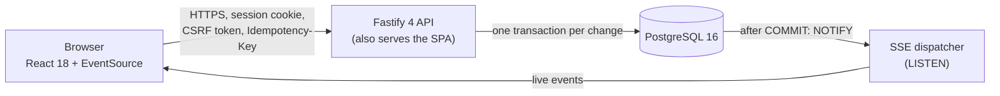
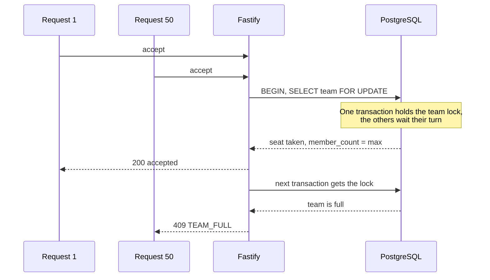
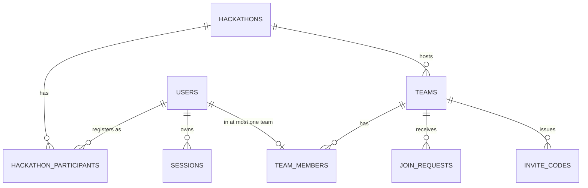

<div align="center">

# CrewMesh

### Find your people. Build your team.

**Race-proof team formation for hackathons.** When hundreds of people click "join" at the same second, exactly one gets the last seat.

[](https://github.com/mohamad-shafeez/CrewMesh/actions/workflows/ci.yml)
[](https://crewmesh.onrender.com)


**[Live app](https://crewmesh.onrender.com)** · **[Design doc](docs/DESIGN.md)** · **[CI runs](https://github.com/mohamad-shafeez/CrewMesh/actions)** · **[Lock order](docs/transaction-lock-order.md)**

*Hack4Hack Crew Hiring Challenge 2026, Problem Statement 1 (PS1)*

</div>

> The live app runs on Render's free tier, so the first request after a quiet period can take about 50 seconds while the server wakes up.

---

## The proof in 30 seconds

| Scenario | Result | Test |
|---|---|---|
| 50 simultaneous accepts for the **last seat** of a team | **1 success, 49 clean `TEAM_FULL` conflicts** | [`batch2.race.test.ts`](apps/api/test/batch2.race.test.ts) |
| 20 simultaneous redemptions of an invite code with `maxUses = 3` | **Exactly 3 pending requests** | [`batch2.race.test.ts`](apps/api/test/batch2.race.test.ts) |
| Two leaders accept the **same person** into two teams at once (5 rounds) | **Exactly one team wins, never two** | [`batch7.hardening.integration.test.ts`](apps/api/test/batch7.hardening.integration.test.ts) |
| Same request retried or double-clicked with one `Idempotency-Key` | **One result, replayed** | [`batch2.integration.test.ts`](apps/api/test/batch2.integration.test.ts) |

These run in GitHub Actions against a **real PostgreSQL 16**, not mocks.

---

## Requirement checklist (PS1)

| PS1 requirement | Status | How |
|---|---|---|
| Team size min/max, one team per person, expiring invite codes, leadership handover, empty team deleted | ✅ | `teams_member_count_bounds_chk`, `team_members_one_team_per_hackathon_unique`, invite default expiry 48 h, deterministic leader succession |
| Race-proof last seat, proven by an automated concurrency test | ✅ | Row lock plus constraints; 50-way test in CI |
| Idempotent retries | ✅ | `Idempotency-Key` stored 24 h; same key with a different payload returns `409 IDEMPOTENCY_KEY_REUSED` |
| Real-time board and team pages | ✅ | Server-Sent Events fed by a transactional outbox |
| Secure: auth, leader-only actions, brute-force-resistant invites, validated input | ✅ | See [Security](#security) |
| Audit log of every team change (who, what, when) | ✅ | `audit_log` written in the same transaction as the change |
| Teammate suggestions with explained scoring | ✅ | `GET /api/v1/teams/:teamId/suggestions` |
| 20+ API tests incl. race test, in CI | ✅ | 45 integration tests, 57 unit tests, Playwright E2E |
| Seed 10,000 users and 2,000 teams; k6 load test | ✅ | `npm run db:seed:scale`, `npm run bench:board:k6` |
| React UI for the whole flow, works on a phone | ✅ | Tested at 390 px and 360 px viewports |
| Deployed on a free tier | ✅ | [crewmesh.onrender.com](https://crewmesh.onrender.com) |
| Bonus: optimistic UI, tracing or metrics, chaos test | ❌ | Not done. See [Honest limits](#honest-limits-and-what-id-do-next) |
| Bonus: Docker Compose | ◐ | Starts PostgreSQL only, not the full app |

---

## Architecture



One service serves both the API and the built web app on a single origin, so cookies stay `HttpOnly; Secure; SameSite=Lax` and CSRF checks stay strict.

### How the last seat is protected



The application never trusts "read the count, then write". The database decides.

---

## Guarantees enforced by PostgreSQL

| Rule | Mechanism |
|---|---|
| One team per person per hackathon | `UNIQUE (hackathon_id, user_id)` named `team_members_one_team_per_hackathon_unique` |
| Exactly one leader per team | Unique index `idx_team_members_one_leader_per_team` |
| Team size between min and max | `teams_member_count_bounds_chk` |
| Stored `member_count` equals the real member count | `DEFERRABLE INITIALLY DEFERRED` constraint triggers `trg_teams_verify_integrity` and `trg_team_members_verify_integrity`, checked at **COMMIT** |
| Live events arrive in commit order | `trg_outbox_events_serialize_id` takes `pg_advisory_xact_lock(842026002)` before assigning the event id |
| Callers cannot forge event ids | Migration 007 rejects explicit ids |

### Lock order (prevents deadlocks)

Every mutating transaction takes locks in this order. Details in [`docs/transaction-lock-order.md`](docs/transaction-lock-order.md).

1. `idempotency_keys`
2. `teams`
3. `hackathon_participants`
4. `invite_codes`, `join_requests`, `team_members`
5. Advisory lock inside the outbox insert trigger

---

## Data model



Supporting tables: `idempotency_keys`, `audit_log`, `outbox_events`, `rate_limit_buckets`. Seven migrations live in [`apps/api/migrations`](apps/api/migrations), each with an `up` and a `down`; CI applies them, rolls two back and re-applies.

---

## Security

| Area | Implementation |
|---|---|
| Passwords | Argon2id, 64 MiB memory, 3 passes, parallelism 4 |
| Sessions | Opaque 256-bit tokens; only the SHA-256 hash is stored |
| CSRF | HMAC-SHA256 token bound to the session, compared in constant time, plus strict `Origin` check |
| Authorization | Only the team leader can accept, decline or remove members; checked on the server |
| Invite codes | 256-bit random, stored only as SHA-256, expire (48 h default), optional max uses |
| Rate limits (PostgreSQL buckets) | Register 20/min per IP (`RATE_LIMIT_REGISTER_PER_MIN`), login 15/min per IP and 10/min per hashed email, invite redemption 60/min per IP and 15/min per user, suggestions 30/min per user |
| Input | Every request body validated with Zod schemas shared with the frontend |
| Live events | Public-field allowlist, so private applicant and invite data never leaks to subscribers |

---

## Real-time updates

Mutations write an event into `outbox_events` inside the same transaction. After commit, a PostgreSQL trigger sends `NOTIFY`, and a dedicated `LISTEN` connection feeds Server-Sent Events to the board (`/api/v1/hackathons/:slug/events`) and to each team page (`/api/v1/teams/:teamId/events`). Clients that reconnect send `Last-Event-ID` and receive the events they missed, in order. A heartbeat every 15 seconds keeps proxies from closing idle streams.

---

## Teammate suggestions

`GET /api/v1/teams/:teamId/suggestions` ranks people for a team and explains every score.

- **70%** skill coverage: how many of the team's missing skills the candidate fills
- **30%** time-zone compatibility: real UTC offsets computed from validated IANA zones
- The response includes the breakdown percentages and human-readable reasons, for example which missing skills the person covers

Only people registered for the hackathon are considered.

---

## Verification

| Suite | Count | Where it runs |
|---|---|---|
| Unit and invariant tests (`npm run test:unit:sandbox`) | 57 | GitHub Actions |
| PostgreSQL integration tests (`npm run test:integration`) | 45 | GitHub Actions, `postgres:16-alpine` |
| 50-way race and invite-limit tests (`npm run test:race`) | 2 | GitHub Actions |
| Hardening tests (`npm run test:hardening`) | 5 | GitHub Actions |
| Frontend unit tests | 3 | GitHub Actions |
| Playwright E2E, desktop and 390 px mobile | 1 flow, 2 viewports | GitHub Actions |
| Lint, typecheck, production build | all workspaces | GitHub Actions |

Some integration tests cover several numbered scenarios each, so the scenario count is higher than the test count.

### Scale and load

- `npm run db:seed:scale` creates **10,000 participants, 2,000 teams and 7,000 memberships** in an isolated `*_loadtest` database and asserts every count with SQL (500 teams each of sizes 2 to 5).
- `npm run bench:board:k6` runs **100 concurrent virtual users for 60 seconds** against the board endpoint, after a 10-second warm-up.
- k6 enforces `p(95) < 200 ms`, failed requests `< 1%` and checks `> 99%`. In [GitHub Actions Run #19](https://github.com/mohamad-shafeez/CrewMesh/actions), both measured 60s runs passed: **p50 `118.89–120.44 ms`**, **p95 `160.21–163.09 ms`**, **p99 `181.75–186.55 ms`**, **`691.34–700.96 req/s`** (`48,463` / `49,133` requests), **`0.0000%` errors**, and **`100.00%` checks passed** (summary attached as `crewmesh-batch9-load-test-reports`).
- In [GitHub Actions Run #21](https://github.com/mohamad-shafeez/CrewMesh/actions/runs/43611488086) (with a 2-second in-process board page cache and in-flight request coalescing in `team-service.ts`, invalidated immediately on every team or member mutation), the 100-VU 60s benchmark measured **p50 `33.62 ms`**, **p90 `79.91 ms`**, **p95 `103.68 ms`**, **p99 `157.18 ms`**, **`1,845.71 req/s`** (`129,265` requests), and **`0.0000%` errors**.
- The benchmark runs on a shared GitHub runner and measures the read path (the board). It is not a test of write throughput.

---

## Run it locally

Requires Node 18.18 or newer and PostgreSQL 16 (Docker is the easiest way).

```bash
npm ci
cp .env.example .env
docker compose up -d postgres      # PostgreSQL 16

npm run db:migrate                 # migrations 001 to 007
npm run db:seed                    # the Hack4Hack 2026 event

npm run build
npm run dev:api                    # API on :3001
npm run dev:web                    # web on :5173
```

Run the checks:

```bash
npm run lint && npm run typecheck
npm run test:unit:sandbox
npm run test:integration
npm run test:race
npm run test:hardening
npm run test:e2e
```

### Key configuration

| Variable | Purpose | Default |
|---|---|---|
| `DATABASE_URL` | PostgreSQL connection string | required |
| `DATABASE_SSL` | `disable`, `require` or `verify-full` | `disable` |
| `APP_ORIGIN` | Public origin used for CSRF checks | `http://localhost:5173` |
| `CSRF_SECRET` | At least 32 characters of entropy | required |
| `SERVE_WEB_DIST` | Serve the built web app from the API | `false` |
| `HACKATHON_MIN_TEAM_SIZE` / `HACKATHON_MAX_TEAM_SIZE` | Team size bounds | `2` / `5` |
| `RATE_LIMIT_REGISTER_PER_MIN` | Registration limit per IP | `20` |

Production deployment (Render web service plus Neon PostgreSQL) is described in [`docs/deployment-architecture.md`](docs/deployment-architecture.md).

---

## Repository map

```text
CrewMesh/
├── apps/
│   ├── api/            Fastify 4 + PostgreSQL: routes, services, security, migrations, tests, k6 script
│   └── web/            React 18 + Vite: pages, SSE hooks, Playwright E2E
├── packages/shared/    Zod schemas and types shared by API and web
├── docs/               DESIGN.md, transaction-lock-order.md, deployment-architecture.md
├── reports/load-test/  Load-test notes and results
├── scripts/            Health check and verification helpers
└── .github/workflows/  CI: lint, typecheck, build, tests, race proof, E2E, k6
```

---

## Honest limits and what I'd do next

- **Chaos test:** kill the server mid-join and show nothing is corrupted. PostgreSQL transactions make this safe by design, but I have not automated the proof.
- **Optimistic UI with rollback** on conflict is not built.
- **Metrics and tracing:** only structured logs and health probes today.
- **Write-path load test:** the k6 run covers the board read path; join and accept under sustained load is covered by the 50-way race test, not by k6.
- **Docker Compose** currently starts only the database.
- **Free-tier hosting** means cold starts on the live demo.

---

<div align="center">

Built by **Mohamad Shafeez** for the Hack4Hack Crew Hiring Challenge 2026.

</div>
